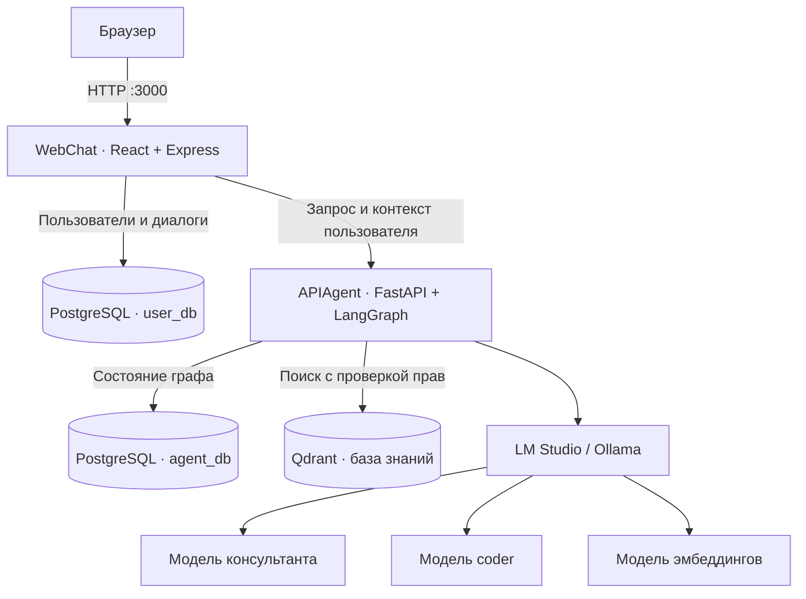

# VIIO — ассистент для работы с базой знаний и кодом

VIIO — платформа с веб-чатом, поиском по документам организации и отдельной моделью для программирования. Сотрудники задают вопросы по доступным им материалам, программисты получают код с учётом проектных сведений, администраторы управляют пользователями и загрузкой документов.

Модели работают через LM Studio или Ollama. Пользователи и история хранятся в PostgreSQL, поисковые фрагменты документов — в Qdrant. Приложение запускается через Docker Compose на Windows и Linux; сервер моделей подготавливается отдельно.

**[Запуск на Windows и Linux](docs/getting-started.md)** · **[Пользователи и загрузка файлов](docs/getting-started.md#5-создать-пользователя)** · **[Настройка coder](docs/coding-agent.md)**

## Содержание

- [Возможности](#возможности)
- [Как устроена система](#как-устроена-система)
- [Быстрый старт](#быстрый-старт)
- [Пользователи и права](#пользователи-и-права)
- [База знаний](#база-знаний)
- [Модель программирования](#модель-программирования)
- [Конфигурация](#конфигурация)
- [Структура проекта](#структура-проекта)
- [Разработка и проверки](#разработка-и-проверки)
- [Текущие ограничения](#текущие-ограничения)
- [Документация](#документация)

## Возможности

| Направление | Что реализовано |
| --- | --- |
| Веб-чат | Регистрация, вход, отдельные диалоги, история сообщений, светлая и тёмная темы, подсветка кода |
| Ответы по документам | Загрузка текста и PDF, OCR сканов через Docling на CPU, поиск с проверкой прав, указание источников |
| Программирование | Отдельная модель coder, автоматическая передача технических задач и прямой вызов через `/code` |
| Тестовая PostgreSQL | Готовый Postgres MCP Pro, чтение схем и SELECT через `/db` и естественные вопросы о подключённой БД, доступ только программистам и администраторам |
| Управление доступом | Роли пользователей, подразделения, права документов и проверка владельца диалога |
| Администрирование | Состояние сервисов, счётчики, управление ролями и подразделениями, каталог и массовая загрузка PDF/TXT/Markdown с сохранением оригиналов |
| Сохранение состояния | Данные веб-чата в `user_db`, состояние диалогового графа в `agent_db` |
| Точность и контекст | Серверный калькулятор простых выражений, отдельный режим редактирования текста, продолжение задач coder и отдельный список предоставленных материалов |

## Как устроена система

В корневом Docker Compose описаны четыре основных сервиса и дополнительные профили `pdf` для Docling и `postgres` для тестовой БД. Сервер моделей работает на хосте или по отдельно настроенному сетевому адресу.



| Сервис | Стек | Ответственность |
| --- | --- | --- |
| `webchat` | React 18, TypeScript, Vite, Tailwind CSS, Express; Node.js 24 в Docker | Интерфейс, пользовательские сессии, диалоги, административные маршруты и передача запросов агенту |
| `apiagent` | Python 3.12, FastAPI, LangChain, LangGraph | Маршрутизация задач, поиск знаний, обращение к моделям и индексация документов |
| `postgres` | PostgreSQL 16 | Две базы: `user_db` для веб-чата и `agent_db` для состояния LangGraph |
| `qdrant` | Qdrant | Хранение поисковых фрагментов и векторов, поиск с фильтрацией доступа |

### Путь запроса

1. WebChat проверяет сессию и принадлежность диалога пользователю.
2. APIAgent получает сообщение и серверный контекст пользователя: идентификатор, роль и подразделения.
3. Основная модель выбирает поиск и делегирование coder. Если она пропустила обязательный поиск по внутреннему вопросу или передачу задачи программирования, сервер выполняет запасной вызов; журнал отличает его от выбора модели. Приветствия, поддерживаемые вычисления и преобразование текста обходят ненужный поиск. Для coder поиск подготавливается сервером, когда задаче нужны проектные сведения.
4. Модель получает доступные фрагменты и формирует ответ. WebChat сохраняет сообщения; LangGraph сохраняет состояние через `AsyncPostgresSaver`.

Короткие продолжения после программирования направляются в историю coder; новая общая тема переключает режим. Доступ к coder проверяется заново на каждом сообщении. При изменении роли или подразделений прежняя история не передаётся модели как текущий контекст. Служебные идентификаторы поисковых фрагментов не передаются в текст справки модели; API возвращает `sources` отдельно от совместимого поля `reply`.

Вычислитель поддерживает десятичные числа, скобки и операции `+`, `-`, `*`, `/`, `%` в коротких выражениях. Он не исполняет код и не решает произвольные текстовые математические задачи. Для основного агента `sources` содержит найденные материалы, названные в ответе; при сообщении об отсутствии сведений список пуст. Это консервативный фильтр ссылок, а не проверка достоверности каждого утверждения. Coder отдельно возвращает предоставленные ему материалы.

Порядок следующих изменений: [единый план улучшений](docs/improvement-plan-2026-10-27.md). Каталог, хранение оригиналов и массовая загрузка доступны в первом рабочем этапе: [инструкция и результаты проверок](docs/release-b1-2026-10-27.md). Добавлены [проверка текста PDF и отмена загрузок](docs/release-b2-review-2026-10-27.md). Добавлены [история и загрузка новых версий документов](docs/release-b3-versions-2026-10-27.md). Отзыв доступа, удаление и внешний консультант остаются в плане.

История coder отделена от истории консультанта и привязана к пользователю и диалогу. При недоступности PostgreSQL для состояния агента предусмотрен переход к памяти процесса; она теряется после перезапуска.

## Быстрый старт

Подготовьте Docker с Compose и запущенный сервер моделей. Полная инструкция, включая сетевые настройки Linux и первого администратора: **[руководство по запуску](docs/getting-started.md)**.

### Windows — PowerShell

Откройте терминал в корне проекта:

```powershell
if (-not (Test-Path -LiteralPath '.env')) { Copy-Item -LiteralPath '.env.example' -Destination '.env' }
notepad .env
```

### Linux — Bash

Откройте терминал в корне проекта:

```bash
if [ ! -f .env ]; then cp .env.example .env; fi
nano .env
```

Укажите в `.env` точные имена доступных моделей, свой `POSTGRES_PASSWORD` и `INTERNAL_API_KEY`. Для первого администратора заполните `BOOTSTRAP_ADMIN_USERNAME` и `BOOTSTRAP_ADMIN_PASSWORD`. Затем на обеих системах выполните:

```text
docker compose config --quiet
docker compose up -d --build
docker compose ps
```

Откройте **[http://localhost:3000](http://localhost:3000)** и войдите созданным из `.env` администратором либо зарегистрируйте сотрудника. Порядок создания первого администратора описан в [инструкции](docs/getting-started.md#назначить-первого-администратора).

### Адреса по умолчанию

| Назначение | Адрес |
| --- | --- |
| Веб-чат | [localhost:3000](http://localhost:3000) |
| Состояние WebChat и подключения к БД | [localhost:3000/health](http://localhost:3000/health) |
| Документация APIAgent | [localhost:8000/docs](http://localhost:8000/docs) |
| Состояние APIAgent | [localhost:8000/health](http://localhost:8000/health) |
| Панель Qdrant | [localhost:6333/dashboard](http://localhost:6333/dashboard) |
| PostgreSQL | `localhost:5432` |

Порты меняются в корневом `.env`. Проверка здоровья API не заменяет проверку ответа модели: после запуска отправьте вопрос в чате.

### Остановка и логи

```text
docker compose logs --tail 100 apiagent webchat
docker compose down
```

Обычный `down` сохраняет данные в томах `postgres_data` и `qdrant_storage`. Флаг `-v` удаляет тома, включая пользователей, историю и знания. Для повторного запуска используйте `docker compose up -d`, после изменения исходников — `docker compose up -d --build`.

## Пользователи и права

Регистрация принимает логин от 3 до 64 символов и пароль не короче 6 символов. Сервер назначает роль `employee` и подразделение `general`. Администратор меняет права уже зарегистрированных пользователей в **«Администрирование → Пользователи»**.

| Роль | Доступ |
| --- | --- |
| Сотрудник — `employee` | Чат и документы, разрешённые ему по правилам доступа |
| Руководитель — `manager` | Чат и документы, доступные его роли и подразделениям |
| Программист — `programmer` | Coder, документы сотрудников и материалы, доступные по другим основаниям |
| Администратор — `admin` | Coder, все документы, административный раздел, управление правами и загрузка знаний |

**Coder доступен программистам и администраторам.** Сотрудники и руководители без этих ролей доступа не получают. Последнего администратора нельзя понизить через интерфейс.

Пароли хранятся в виде хешей. Сессия передаётся через HttpOnly-cookie `session_id`; production-сборка включает Secure. Для удалённого доступа используйте HTTPS. Диалоги доступны только владельцам.

## База знаний

Администратор открывает **«Администрирование → База знаний»**, выбирает PDF или текстовый файл, проверяет извлечённый текст, указывает название и права, затем нажимает **«Добавить в базу знаний»**. Для сканов запускается [Docling на CPU](docs/pdf-upload.md).

| Параметр | Поддержка |
| --- | --- |
| Форматы файлов | `.pdf`, `.txt`, `.md`, `.markdown`; для текстовых файлов рекомендуется UTF-8 |
| Размер файла | PDF до 10 МБ / 50 страниц; TXT/Markdown до 2 МБ |
| Размер текста | До 500 000 символов |
| Название | До 255 символов |
| Варианты доступа | Сотрудникам, выбранным подразделениям, администраторам или всем |

APIAgent разбивает текст на фрагменты, вычисляет эмбеддинги и сохраняет их в Qdrant. При поиске применяются права из метаданных: `is_public`, `allowed_roles`, `allowed_departments`, `owner_id`. Достаточно разрешения по одному основанию; администратор и автор сохраняют доступ.

Документы передаются модели как справочный контекст. Промпт предписывает не выполнять инструкции из документов; это дополняет серверную проверку доступа, но не гарантирует отсутствие ошибок модели.

Подробные действия и проверка загрузки: [работа с файлами](docs/getting-started.md#6-загрузить-файлы-в-базу-знаний).

## Модель программирования

Coder получает задачу и подготовленный контекст, затем возвращает код в чат. Ему не передаются инструменты создания файлов, запуска команд или обращения к базе данных.

```text
/code Напиши Python-функцию проверки ИНН.
/code По документу «Описание API заказов» напиши клиент метода создания заказа.
/code Добавь обработку ошибок в предыдущий пример.
```

Технические запросы могут передаваться coder автоматически. Для явного выбора модели и коротких продолжений используйте `/code`.

Для проектных задач сервер ищет сведения с текущими правами пользователя и передаёт их только в текущий вызов coder. По умолчанию размер справки ограничен 6000 символами. Если явно названный документ не найден среди доступных результатов, система просит уточнить источник.

Модель задаётся через `CODING_MODEL`; пустое значение означает использование модели консультанта. Провайдер общий — LM Studio или Ollama. Подробнее: [настройка, маршрутизация и ограничения coder](docs/coding-agent.md).

## Конфигурация

Основной образец настроек — [`.env.example`](.env.example). Для всей платформы используется `.env` рядом с корневым `docker-compose.yml`.

| Группа | Основные переменные |
| --- | --- |
| Провайдер | `LLM_PROVIDER`: `lmstudio` или `ollama` |
| LM Studio | `LMSTUDIO_BASE_URL`, `LMSTUDIO_API_KEY`, `LMSTUDIO_MODEL`, `LMSTUDIO_EMBEDDING_MODEL` |
| Ollama | `OLLAMA_BASE_URL`, `OLLAMA_MODEL`, `OLLAMA_EMBEDDING_MODEL` |
| Coder | `CODING_AGENT_ENABLED`, `CODING_MODEL`, `CODING_ALLOWED_ROLES`, `CODING_CONTEXT_MAX_CHARS` |
| База знаний | `QDRANT_COLLECTION_NAME`, `RAG_CHUNK_UNIT`, `RAG_CHUNK_SIZE`, `RAG_CHUNK_OVERLAP`, `RAG_CONTEXT_MAX_CHARS` |
| PostgreSQL | `POSTGRES_USER`, `POSTGRES_PASSWORD`, `POSTGRES_PORT` |
| Внешние порты | `WEBCHAT_PORT`, `API_PORT`, `QDRANT_PORT`, `QDRANT_GRPC_PORT` |
| Генерация консультанта | `CHAT_TEMPERATURE`, `CHAT_TOP_P`, `CHAT_MAX_TOKENS` |
| Генерация coder | `CODING_TEMPERATURE`, `CODING_TOP_P`, `CODING_MAX_TOKENS` |
| Первый администратор | `BOOTSTRAP_ADMIN_USERNAME`, `BOOTSTRAP_ADMIN_PASSWORD` (оба пусты — выключено) |
| Межсервисный доступ | `INTERNAL_API_KEY` |
| Тестовая PostgreSQL | `PGSQL_ENABLED`, `PGSQL_HOST`, `PGSQL_PORT`, `PGSQL_DATABASE`, `PGSQL_USER`, `PGSQL_PASSWORD`; [подключение и команды](docs/postgresql-tool.md) |

Для сервера моделей на хосте контейнер APIAgent использует `host.docker.internal`. Корневой Compose содержит соответствующее сопоставление для Linux. Сервер моделей должен слушать адрес, доступный контейнерам.

WebChat добавляет `X-Internal-Token` к защищённым запросам APIAgent. Этот токен предназначен для серверного обмена, а не для входа пользователя. При прямой интеграции его требуют `POST /api/v1/chat` и `POST /api/v1/documents`; схемы и примеры — в [APIAgent/README.md](APIAgent/README.md).

## Структура проекта

```text
VIIO/
├── APIAgent/
│   ├── src/apiagent/
│   │   ├── models/          # Фабрики моделей: chat, coder, embeddings
│   │   ├── services/        # Граф агента, маршрутизация, документы
│   │   ├── tools/           # Поиск в базе знаний
│   │   ├── interfaces/      # Контракты сервисов
│   │   ├── utils/           # Адаптеры хранилищ и инфраструктура
│   │   ├── prompts.py       # Короткие инструкции консультанта и coder
│   │   ├── config.py        # Настройки из окружения
│   │   └── router.py        # HTTP API и схемы запросов
│   └── tests/
├── WebChat/
│   ├── src/                # React-интерфейс
│   ├── server/             # Express, сессии, чат и администрирование
│   └── test/
├── init-db/                # Первичная инициализация баз PostgreSQL
├── docs/                   # Руководства, исследования и отчёты проверок
├── .env.example
└── docker-compose.yml      # Запуск всей платформы
```

## Разработка и проверки

Для локальной разработки нужны Node.js 22+, Python 3.12+ и `uv`, а также отдельно запущенные PostgreSQL, Qdrant и сервер моделей. Настройки подключения задаются в окружении соответствующего приложения. Корневой `.env` используется Compose и автоматически не заменяет настройки локальных процессов.

Команды выполняются из указанных каталогов:

```bash
# WebChat/
npm ci
npm test
npm run build
npm start
```

```bash
# APIAgent/
uv sync
uv run pytest tests/
uv run uvicorn apiagent:create_app --factory --reload --port 8000
```

Тесты и сборка проверяют приложение; фактическое качество ответов локальной модели и корректность загруженных знаний оцениваются отдельно. Инструкции компонентов: [WebChat](WebChat/README.md) и [APIAgent](APIAgent/README.md).

## Текущие ограничения

- PDF загружаются через веб-форму; сканам нужен дополнительный CPU-сервис. [Настройка Docling и ограничения](docs/pdf-upload.md). DOCX, таблицы XLSX, отдельные изображения и архивы пока требуют предварительного извлечения текста.
- Интерфейс не поддерживает просмотр, изменение и удаление уже загруженных документов. Повторная загрузка создаёт новый документ.
- Coder пишет код, но не выполняет и не тестирует его. Результат требует проверки перед использованием.
- Короткое продолжение без `/code` может попасть консультанту вместо coder.
- Чат возвращает готовый ответ; потоковая выдача и отображение этапов работы пока не реализованы.
- После смены модели эмбеддингов может потребоваться новая коллекция и повторная индексация документов.
- Скрипт создания `user_db` и `agent_db` запускается только при инициализации пустого тома PostgreSQL.

## Документация

| Документ | Содержание |
| --- | --- |
| [Запуск и первые действия](docs/getting-started.md) | Windows, Linux, `.env`, первый администратор, пользователи, загрузка файлов, частые ошибки |
| [Модель coder](docs/coding-agent.md) | Настройки, доступ программистов, поиск контекста и примеры запросов |
| [Инструмент PostgreSQL](docs/postgresql-tool.md) | Настройки тестовой БД, профиль Docker, роли, SELECT и отсутствие сохранения результатов |
| [Обработка запросов](docs/request-performance.md) | Поиск без лишних обращений, лимит контекста, параллельность coder и 140 тестов |
| [WebChat](WebChat/README.md) | Запуск интерфейса и сервера, маршруты, сборка и проверки |
| [APIAgent](APIAgent/README.md) | Устройство сервиса, локальный запуск и HTTP API |
| [Административный интерфейс](docs/admin-ui.md) | Возможности, правила доступа и результаты проверки интерфейса |
| [Оформление интерфейса](DESIGN.md) | Цвета, компоненты и адаптивное поведение |
| [Оценка системы · 26.10.2026](docs/system-evaluation-2026-10-26.md) | Результаты проверки системы на указанную дату |
| [Проверка coder, знаний и ролей · 26.10.2026](docs/coder-knowledge-role-verification-2026-10-26.md) | Сценарии доступа и передачи знаний модели |

Исследования в `docs/` содержат отдельные рекомендации и не означают, что описанные изменения уже реализованы.

## Поиск, память и внешний консультант

Добавлены объединённый поиск по документам и именам исходников, загрузка кода для программистов/администраторов, сводки длинных бесед и явные личные факты (`/remember`, `/facts`, `/forget`). Внешний консультант доступен отдельным API и использует только тексты, явно опубликованные администратором. [Настройка, команды и ограничения](docs/release-c-knowledge-memory-consultant-2026-10-27.md).

Внешний консультант вынесен в [отдельное приложение и Docker-контейнер Consultant](Consultant/README.md), порт 8001. Модель настраивается независимо; прежний адрес на порту 8000 сохранён как прокси. [Архитектура и проверки](docs/consultant-container-2026-10-27.md).
