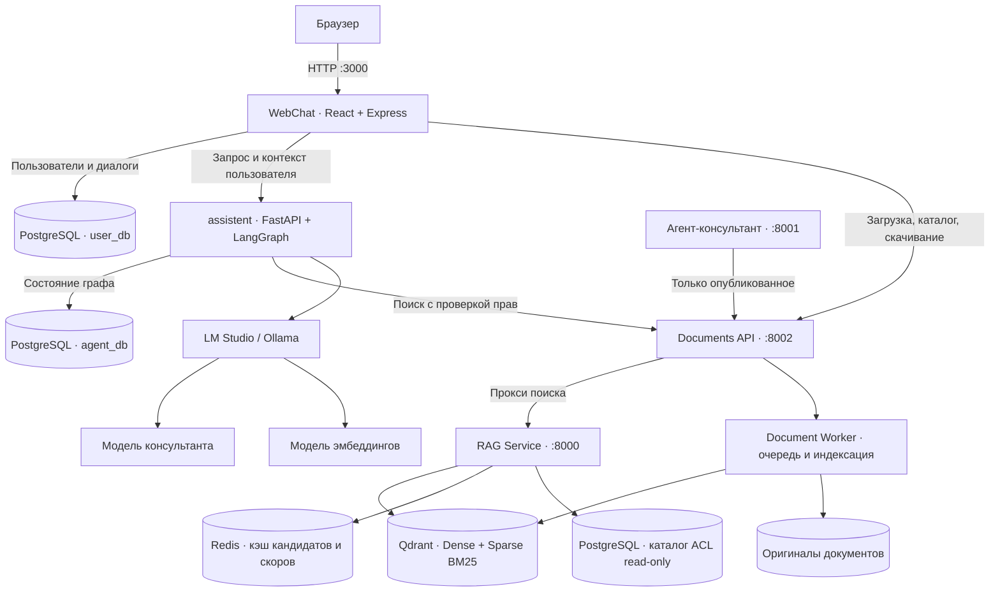

# VIIO — ассистент для работы с базой знаний и кодом

VIIO — платформа с веб-чатом, поиском по документам организации и единым агентом с инструментами по правам пользователя. Сотрудники задают вопросы по доступным им материалам, программисты получают код с учётом проектных сведений, администраторы управляют пользователями и загрузкой документов.

Модели работают через Yandex AI Studio, LM Studio или Ollama. Пользователи и история хранятся в PostgreSQL, поисковые фрагменты документов — в Qdrant, а кэш поиска и скоров — в Redis. Приложение запускается через Docker Compose на Windows и Linux; сервер моделей подготавливается отдельно.

**[Запуск на Windows и Linux](docs/getting-started.md)** · **[Пользователи и загрузка файлов](docs/getting-started.md#5-создать-пользователя)** · **[Инструменты агента](docs/mcp-integrations.md)**

## Содержание

- [Возможности](#возможности)
- [Как устроена система](#как-устроена-система)
- [Быстрый старт](#быстрый-старт)
- [Пользователи и права](#пользователи-и-права)
- [База знаний](#база-знаний)
- [Модель программирования](#модель-программирования)
- [Конфигурация](#конфигурация)
- [Структура проекта](#структура-проекта)
- [Разработка и проверки](#разработка-и-проверки)
- [Текущие ограничения](#текущие-ограничения)
- [Документация](#документация)

## Возможности

| Направление | Что реализовано |
| --- | --- |
| Веб-чат | Регистрация, вход, отдельные диалоги, история сообщений, светлая и тёмная темы, подсветка кода |
| Ответы по документам | PDF, DOCX, ODT и текст; двухэтапный поиск (Dense + Sparse BM25 + лексика через RRF, переранжирование Cross-Encoder BAAI/bge-reranker-v2-m3 на CPU ONNX), расширение контекста Small2Big (Sentence-Window), кэширование в Redis, OCR PDF через Docling на CPU, поиск с проверкой прав и источниками |
| Программирование | Отдельная модель coder, автоматическая передача технических задач и прямой вызов через `/code` |
| Тестовая PostgreSQL | Готовый Postgres MCP Pro, чтение схем и SELECT через `/db` и естественные вопросы о подключённой БД, доступ только программистам и администраторам |
| Управление доступом | Роли пользователей, подразделения, права документов и проверка владельца диалога |
| Администрирование | Состояние сервисов, счётчики, управление ролями и подразделениями, каталог и массовая загрузка PDF/TXT/Markdown с сохранением оригиналов |
| Сохранение состояния | Данные веб-чата в `user_db`, состояние диалогового графа в `agent_db` |
| Точность и контекст | Серверный калькулятор простых выражений, отдельный режим редактирования текста, продолжение задач coder и отдельный список предоставленных материалов |

## Как устроена система

В корневом Docker Compose описаны четыре основных сервиса и дополнительные профили `pdf` для Docling и `postgres` для тестовой БД. Сервер моделей работает на хосте или по отдельно настроенному сетевому адресу.



| Сервис | Стек | Ответственность |
| --- | --- | --- |
| `webchat` | React 18, TypeScript, Vite, Tailwind CSS, Express; Node.js 24 в Docker | Интерфейс, пользовательские сессии, диалоги, административные маршруты и передача запросов агенту |
| `assistent` | Python 3.12, FastAPI, LangChain, LangGraph | Основной агент, coder, диалоги и личные факты; поиск через Documents API |
| `consultant` | FastAPI, LangChain | Самостоятельный агент-консультант; инструмент поиска разрешённых публикаций |
| `documents` | FastAPI, PostgreSQL, Qdrant | Общий каталог, права, версии, публикации, загрузка, скачивание; совместимые поисковые URL передают запросы в RAG |
| `rag` | FastAPI, FastEmbed (ONNX), PostgreSQL read-only, Qdrant read-only, Redis | Двухэтапный гибридный поиск (Dense + Sparse BM25 + каталог по RRF), Cross-Encoder переранжирование, Small2Big контекст, ACL и трассировка |
| `redis` | Redis 7.2 Alpine | Высокоскоростное кэширование сырых кандидатов поиска и скоров переранжирования |
| `document-worker` | Python, очередь PostgreSQL | Обработка файлов, PDF/OCR, индексация и синхронизация публикаций в отдельном процессе |
| `postgres` | PostgreSQL 16 | Две базы: `user_db` для веб-чата и `agent_db` для состояния LangGraph |
| `qdrant` | Qdrant | Хранение плотных векторов и Sparse BM25 фрагментов, поиск с фильтрацией доступа |

Каталог основного проекта — `Assistent`, Python-пакет и Docker-сервис — `assistent`, контейнер — `viio_assistent`. Documents и worker используют самостоятельный пакет `viio_documents` из `Documents/src` со своими зависимостями и Docker-сборкой. Связь агентов с документами проходит только по HTTP; модели диалога/coder в Documents не создаются. У основного агента нет тома с оригиналами и обработчиков очереди. [Границы сервисов и запуск](Documents/README.md).

### Путь запроса

1. WebChat проверяет сессию и принадлежность диалога пользователю.
2. assistent получает сообщение и серверный контекст пользователя: идентификатор, роль и подразделения.
3. Основная модель выбирает поиск и делегирование coder. Если она пропустила обязательный поиск по внутреннему вопросу или передачу задачи программирования, сервер выполняет запасной вызов; журнал отличает его от выбора модели. Приветствия, поддерживаемые вычисления и преобразование текста обходят ненужный поиск. Для coder поиск подготавливается сервером, когда задаче нужны проектные сведения.
4. Модель получает доступные фрагменты и формирует ответ. WebChat сохраняет сообщения; LangGraph сохраняет состояние через `AsyncPostgresSaver`.

Агент использует общую историю диалога и проверяет текущие права перед вызовами инструментов. При изменении роли или подразделений прежняя история не передаётся модели как текущий контекст. Служебные идентификаторы поисковых фрагментов не передаются в текст справки модели; API возвращает `sources` отдельно от совместимого поля `reply`.

Вычислитель поддерживает десятичные числа, скобки и операции `+`, `-`, `*`, `/`, `%` в коротких выражениях. Он не исполняет код и не решает произвольные текстовые математические задачи. Для основного агента `sources` содержит найденные материалы, названные в ответе; при сообщении об отсутствии сведений список пуст. Это консервативный фильтр ссылок, а не проверка достоверности каждого утверждения. Coder отдельно возвращает предоставленные ему материалы.

Каталог, хранение оригиналов и массовая загрузка доступны в первом рабочем этапе: [инструкция и результаты проверок](docs/getting-started.md). Добавлены [проверка текста PDF и отмена загрузок](docs/pdf-upload.md), [история и загрузка новых версий документов](docs/getting-started.md) и [отдельный внешний API-консультант](Consultant/README.md). В общедоступную БЗ загружены 40 файлов ГосАптеки. Отзыв доступа и удаление документов остаются в плане.

Агент использует общую историю диалога и проверяет текущие права перед вызовами инструментов. При недоступности PostgreSQL для состояния агента предусмотрен переход к памяти процесса; она теряется после перезапуска.

## Быстрый старт

Подготовьте Docker с Compose и запущенный сервер моделей. Полная инструкция, включая сетевые настройки Linux и первого администратора: **[руководство по запуску](docs/getting-started.md)**.

### Windows — PowerShell

Откройте терминал в корне проекта:

```powershell
if (-not (Test-Path -LiteralPath '.env')) { Copy-Item -LiteralPath '.env.example' -Destination '.env' }
notepad .env
```

### Linux — Bash

Откройте терминал в корне проекта:

```bash
if [ ! -f .env ]; then cp .env.example .env; fi
nano .env
```

Укажите в `.env` точные имена доступных моделей, свой `POSTGRES_PASSWORD` и `INTERNAL_API_KEY`. Для первого администратора заполните `BOOTSTRAP_ADMIN_USERNAME` и `BOOTSTRAP_ADMIN_PASSWORD`. Затем на обеих системах выполните:

```text
docker compose config --quiet
docker compose up -d --build
docker compose ps
```

Откройте **[http://localhost:3000](http://localhost:3000)** и войдите созданным из `.env` администратором либо зарегистрируйте сотрудника. Порядок создания первого администратора описан в [инструкции](docs/getting-started.md#назначить-первого-администратора).

### Адреса по умолчанию

| Назначение | Адрес |
| --- | --- |
| Веб-чат | [localhost:3000](http://localhost:3000) |
| Состояние WebChat и подключения к БД | [localhost:3000/health](http://localhost:3000/health) |
| Документация assistent | [localhost:8000/docs](http://localhost:8000/docs) |
| Состояние assistent | [localhost:8000/health](http://localhost:8000/health) |
| Панель Qdrant | [localhost:6333/dashboard](http://localhost:6333/dashboard) |
| PostgreSQL | `localhost:5432` |
| Redis | `localhost:6379` |
| Диагностика поиска и агентов | [localhost:3010](http://localhost:3010) |

Порты меняются в корневом `.env`. Проверка здоровья API не заменяет проверку ответа модели: после запуска отправьте вопрос в чате.

### Остановка и логи

```text
docker compose logs --tail 100 assistent webchat
docker compose down
```

Обычный `down` сохраняет данные в томах `postgres_data` и `qdrant_storage`. Флаг `-v` удаляет тома, включая пользователей, историю и знания. Для повторного запуска используйте `docker compose up -d`, после изменения исходников — `docker compose up -d --build`.

## Пользователи и права

Регистрация принимает логин от 3 до 64 символов и пароль не короче 6 символов. Сервер назначает роль `employee` и подразделение `general`. Администратор меняет права уже зарегистрированных пользователей в **«Администрирование → Пользователи»**.

| Роль | Доступ |
| --- | --- |
| Сотрудник — `employee` | Чат и документы, разрешённые ему по правилам доступа |
| Руководитель — `manager` | Чат и документы, доступные его роли и подразделениям |
| Программист — `programmer` | Coder, документы сотрудников и материалы, доступные по другим основаниям |
| Администратор — `admin` | Coder, все документы, административный раздел, управление правами и загрузка знаний |

**Инструменты GitHub и PostgreSQL доступны программистам и администраторам** при включённых интеграциях. Основной агент работает для всех пользователей; права на документы проверяются отдельно. Последнего администратора нельзя понизить через интерфейс.

Пароли хранятся в виде хешей. Сессия передаётся через HttpOnly-cookie `session_id`; production-сборка включает Secure. Для удалённого доступа используйте HTTPS. Диалоги доступны только владельцам.

## База знаний

Администратор открывает **«Администрирование → База знаний»**, выбирает PDF или текстовый файл, проверяет извлечённый текст, указывает название и права, затем нажимает **«Добавить в базу знаний»**. Для сканов запускается [Docling на CPU](docs/pdf-upload.md).

| Параметр | Поддержка |
| --- | --- |
| Форматы файлов | `.pdf`, `.txt`, `.md`, `.markdown`; для текстовых файлов рекомендуется UTF-8 |
| Размер файла | PDF до 10 МБ / 50 страниц; TXT/Markdown до 2 МБ |
| Размер текста | До 500 000 символов |
| Название | До 255 символов |
| Варианты доступа | Сотрудникам, выбранным подразделениям, администраторам или всем |

При индексации применяется **Small2Big (Sentence-Window) чанкинг**: текст нарезается на компактные смысловые фрагменты (микро-чанки) для максимальной точности векторного сходства, а в метаданные каждого фрагмента сохраняется расширенное связное окно предложений (`window_context`).

Поиск документов устроен как **двухэтапный гибридный конвейер**:
1. **Многопоточный отбор пула кандидатов:**
   - *Плотный семантический поиск (Dense)* в Qdrant по векторным расстояниям.
   - *Разреженный поиск (Sparse BM25)* в Qdrant с использованием модели `Qdrant/bm25` (библиотека `fastembed`) и нативного модификатора IDF.
   - *Лексический поиск* по каталогу документов в PostgreSQL.
   - Результаты объединяются по алгоритму Reciprocal Rank Fusion (RRF).
2. **Строгая авторизация ACL:** все кандидаты динамически проверяются по каталогу PostgreSQL с учётом текущей роли, подразделений и авторства пользователя.
3. **Cross-Encoder переранжирование:** локальная ONNX-модель `BAAI/bge-reranker-v2-m3` (на CPU, без видеокарты) переоценивает релевантность топ-кандидатов и отсекает ложные совпадения по порогу `RERANKER_MIN_SCORE`.
4. **Контекстное расширение Small2Big:** для отобранных фрагментов в промпт модели передаётся связное окно предложений, что гарантирует целостность фраз без обрыва мыслей.
5. **Кэширование в Redis:** сырые кандидаты поиска и результаты переранжирования кэшируются в Redis (с автоматическим fallback в память процесса при недоступности кэша), обеспечивая мгновенный повторный ответ.

Для внешних пользователей служит отдельная коллекция `knowledge_public`: в ней находятся только явно опубликованные администратором снимки. Основной агент ищет и в ней, и в доступных внутренних материалах; консультант — только в публичной. Флаг `is_public` сам по себе не включает внешнюю публикацию. [Устройство индексов, синхронизация и проверки](docs/public-qdrant-2026-10-27.md).

Документы передаются модели как справочный контекст. Промпт предписывает не выполнять инструкции из документов; это дополняет серверную проверку доступа, но не гарантирует отсутствие ошибок модели.

Подробные действия и проверка загрузки: [работа с файлами](docs/getting-started.md#6-загрузить-файлы-в-базу-знаний).

## Единый агент и инструменты

Основной агент отвечает на вопросы и пишет код в общей истории. Модель задаётся
через `CHAT_PROVIDER` / `CHAT_MODEL` с наследованием `LLM_PROVIDER`.
Отдельные coder и DB-агент не создаются; команды переключения не нужны.

Инструменты отбираются перед каждым вызовом модели по текущим правам пользователя:
поиск по БЗ — с проверкой доступа к документам; GitHub и PostgreSQL — только
для разрешённых ролей и при включённых интеграциях. Проверка роли повторяется
при выполнении инструмента. После смены роли прежний закрытый контекст отсекается.

Примеры: «Какие репозитории тебе доступны?», «Покажи файл README.md из owner/repo»,
«Покажи таблицы подключённой PostgreSQL». GitHub и БД доступны только на чтение.
Настройка: [интеграции MCP](docs/mcp-integrations.md).

## Конфигурация

Основной образец настроек — [`.env.example`](.env.example). Для всей платформы используется `.env` рядом с корневым `docker-compose.yml`.

| Группа | Основные переменные |
| --- | --- |
| Провайдер | `LLM_PROVIDER`: `lmstudio` или `ollama` |
| LM Studio | `LMSTUDIO_BASE_URL`, `LMSTUDIO_API_KEY`, `LMSTUDIO_MODEL`, `LMSTUDIO_EMBEDDING_MODEL` |
| Ollama | `OLLAMA_BASE_URL`, `OLLAMA_MODEL`, `OLLAMA_EMBEDDING_MODEL` |
| Coder | `CODING_AGENT_ENABLED`, `CODING_MODEL`, `CODING_ALLOWED_ROLES`, `CODING_CONTEXT_MAX_CHARS` |
| База знаний | `QDRANT_COLLECTION_NAME`, `QDRANT_PUBLIC_COLLECTION_NAME`, `RAG_CHUNK_UNIT`, `RAG_CHUNK_SIZE`, `RAG_CHUNK_OVERLAP`, `RAG_CONTEXT_MAX_CHARS` |
| RAG и Reranker | `RERANKER_ENABLED`, `RERANKER_MODEL`, `RERANKER_TOP_K`, `SPARSE_BM25_ENABLED`, `SMALL2BIG_ENABLED` |
| Redis кэширование | `REDIS_URL`, `REDIS_HOST`, `REDIS_PORT`, `REDIS_ENABLED`, `REDIS_CACHE_TTL` |
| PostgreSQL | `POSTGRES_USER`, `POSTGRES_PASSWORD`, `POSTGRES_PORT` |
| Внешние порты | `WEBCHAT_PORT`, `API_PORT`, `QDRANT_PORT`, `QDRANT_GRPC_PORT`, `REDIS_PORT` |
| Генерация консультанта | `CHAT_TEMPERATURE`, `CHAT_TOP_P`, `CHAT_MAX_TOKENS` |
| Генерация coder | `CODING_TEMPERATURE`, `CODING_TOP_P`, `CODING_MAX_TOKENS` |
| Первый администратор | `BOOTSTRAP_ADMIN_USERNAME`, `BOOTSTRAP_ADMIN_PASSWORD` (оба пусты — выключено) |
| Межсервисный доступ | `INTERNAL_API_KEY` |
| Тестовая PostgreSQL | `PGSQL_ENABLED`, `PGSQL_HOST`, `PGSQL_PORT`, `PGSQL_DATABASE`, `PGSQL_USER`, `PGSQL_PASSWORD`; [подключение и команды](docs/postgresql-tool.md) |

Для сервера моделей на хосте контейнер assistent использует `host.docker.internal`. Корневой Compose содержит соответствующее сопоставление для Linux. Сервер моделей должен слушать адрес, доступный контейнерам.

WebChat добавляет `X-Internal-Token` к защищённым запросам assistent. Этот токен предназначен для серверного обмена, а не для входа пользователя. При прямой интеграции его требуют `POST /api/v1/chat` и `POST /api/v1/documents`; схемы и примеры — в [Assistent/README.md](Assistent/README.md).

## Структура проекта

```text
VIIO/
├── Assistent/              # Единый LangGraph-агент, диалог, coder и инструменты
├── RAG/                    # Двухэтапный гибридный поиск, Sparse BM25, Reranker, кэш
├── Documents/              # Каталог документов, права (ACL), очереди и worker
├── Consultant/             # Самостоятельный агент-консультант
├── Diagnostics/            # Веб-панель телеметрии запросов, OCR и RAG (порт 3010)
├── WebChat/
│   ├── src/                # React-интерфейс
│   ├── server/             # Express, сессии, чат и администрирование
│   └── test/
├── init-db/                # Первичная инициализация баз PostgreSQL
├── docs/                   # Документация системы; рабочие отчёты игнорируются Git
├── .env.example
└── docker-compose.yml      # Запуск всей платформы
```

## Разработка и проверки

Для локальной разработки нужны Node.js 22+, Python 3.12+ и `uv`, а также отдельно запущенные PostgreSQL, Qdrant и сервер моделей. Настройки подключения задаются в окружении соответствующего приложения. Корневой `.env` используется Compose и автоматически не заменяет настройки локальных процессов.

Команды выполняются из указанных каталогов:

```bash
# WebChat/
npm ci
npm test
npm run build
npm start
```

```bash
# Assistent/
uv sync
uv run pytest tests/
uv run uvicorn assistent:create_app --factory --reload --port 8000
```

Тесты и сборка проверяют приложение; фактическое качество ответов локальной модели и корректность загруженных знаний оцениваются отдельно. Инструкции компонентов: [WebChat](WebChat/README.md) и [assistent](Assistent/README.md).

Для соблюдения стандартов кодовой базы, оркестрации LangGraph, оптимизации RAG и промптов подключены [скиллы агентов](docs/agent-skills.md) в каталоге `.agents/skills`.

## Текущие ограничения

- PDF загружаются через веб-форму; сканам нужен дополнительный CPU-сервис. [Настройка Docling и ограничения](docs/pdf-upload.md). DOCX, таблицы XLSX, отдельные изображения и архивы пока требуют предварительного извлечения текста.
- Интерфейс не поддерживает просмотр, изменение и удаление уже загруженных документов. Повторная загрузка создаёт новый документ.
- Coder пишет код, но не выполняет и не тестирует его. Результат требует проверки перед использованием.
- Короткое продолжение без `/code` может попасть консультанту вместо coder.
- Чат возвращает готовый ответ; потоковая выдача и отображение этапов работы пока не реализованы.
- После смены модели эмбеддингов может потребоваться новая коллекция и повторная индексация документов.
- Скрипт создания `user_db` и `agent_db` запускается только при инициализации пустого тома PostgreSQL.

## Документация

| Документ | Содержание |
| --- | --- |
| [Запуск и первые действия](docs/getting-started.md) | Windows, Linux, `.env`, первый администратор, пользователи, загрузка файлов, частые ошибки |
| [Модель coder](docs/mcp-integrations.md) | Настройки, доступ программистов, поиск контекста и примеры запросов |
| [Инструмент PostgreSQL](docs/postgresql-tool.md) | Настройки тестовой БД, профиль Docker, роли, SELECT и отсутствие сохранения результатов |
| [Обработка запросов](docs/ready-agent-components.md) | Поиск без лишних обращений, лимит контекста, параллельность coder и 140 тестов |
| [WebChat](WebChat/README.md) | Запуск интерфейса и сервера, маршруты, сборка и проверки |
| [assistent](Assistent/README.md) | Устройство сервиса, локальный запуск и HTTP API |
| [Административный интерфейс](docs/admin-ui.md) | Возможности, правила доступа и результаты проверки интерфейса |
| [Оформление интерфейса](DESIGN.md) | Цвета, компоненты и адаптивное поведение |
| [Скиллы агентов](docs/agent-skills.md) | Каталог и использование скиллов (.agents/skills), архитектура, промпты, RAG и поиск |

В Git хранится документация по устройству, настройке и эксплуатации системы. Рабочие отчёты, выгрузки проверок, исследования и планы в `docs/` остаются локально и исключены через `.gitignore`.

## Поиск, память и внешний консультант

Добавлены объединённый поиск по документам и именам исходников, загрузка кода для программистов/администраторов, сводки длинных бесед и явные личные факты (`/remember`, `/facts`, `/forget`). Внешний консультант доступен отдельным API и использует только тексты, явно опубликованные администратором. [Настройка, команды и ограничения](docs/dialogue-summarization.md).

Внешний консультант вынесен в [отдельное приложение и Docker-контейнер Consultant](Consultant/README.md), порт 8001. Модель настраивается независимо; прежний адрес на порту 8000 сохранён как прокси. [Архитектура и проверки](Consultant/README.md).

Консультант — самостоятельный агент со своей целью и инструментом `search_published_documents`. Модель сама выбирает запрос и при необходимости повторяет поиск. Он использует общую базу основного агента через серверный шлюз, который допускает только опубликованные документы. [Роль, ограничения и тесты агента](Consultant/README.md).

Порядок защищённого запуска и миграции: [выпуск A](docs/release-a-2026-10-28.md).
