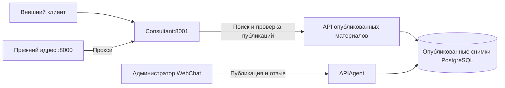

# Отдельный агент и контейнер консультанта

27 октября 2026. Консультант вынесен в пакет `Consultant/src/viio_consultant` с собственными настройками, зависимостями и Dockerfile.

API основной системы больше не создаёт модель внешнего консультанта. Старый адрес сохранён как HTTP-прокси; внутренний агент не используется как запасной обработчик при сбое отдельного сервиса.

Сервис консультанта не импортирует APIAgent, LangGraph, PostgreSQL/Qdrant-драйверы или MCP. Он получает только публичный текст через два узких служебных маршрута, с отдельным ключом. Сеть и окружение Docker отделены от внутренних баз. Веса модели по-прежнему находятся у настроенного провайдера; модель консультанта можно выбрать независимо.

[Запуск, ключи и настройки модели](../Consultant/README.md).

## Проверки перед выпуском

219 автоматических проверок APIAgent и консультанта прошли, включая отдельные HTTP-приложения, публикацию/отзыв, запрет внутренних маршрутов, несовместимость ключей, сохранение старого URL и отсутствие внутренних импортов. Docker-сборка дополнительно выполняет тесты консультанта с его собственными зафиксированными зависимостями.

По запросу пользователя подготовлен живой набор из 20 сценариев ответов: факты, сроки, цены, сравнение, арифметика, отсутствующие сведения, ложные предпосылки, попытки получить SQL и внутренние данные, сменить роль, ошибочные ключи и отзыв публикации. Используются только синтетические документы; результаты фиксируются отдельным отчётом после запуска выделенного контейнера.

При первом живом прогоне смысловые проверки прошли, но ручной просмотр выявил служебные теги источников в трёх ответах. Добавлена очистка тегов с сохранением опубликованного названия, тест этой обработки и проверка отсутствия тегов в живом сценарии. [Первичный отчёт](consultant-evaluation-before-format-fix-2026-10-27.jsonl) сохранён для сравнения.

Финальный прогон: 20/20 сценариев прошли, служебных тегов нет. Проверены независимый перезапуск и готовность API после него. [Полный отчёт с примерами ответов](consultant-evaluation-2026-10-27.md). Сервисы работают, тестовые документы и публикации очищены.
