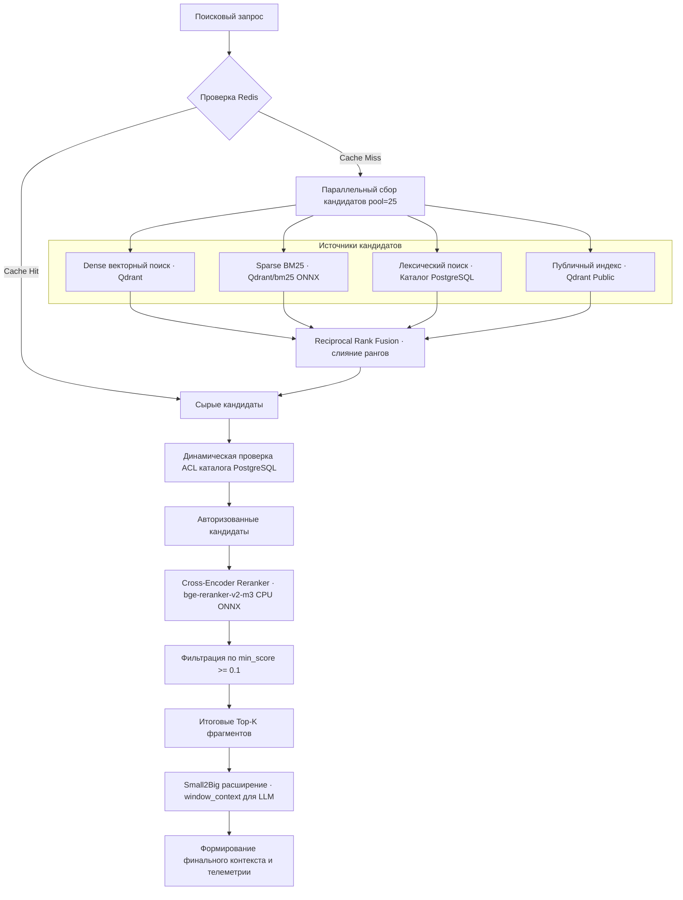

# VIIO RAG

Все реализации поиска находятся здесь: рабочий локальный RAG VIIO и
тест управляемого RAG Yandex AI Studio.

Выбор режима для ассистента и консультанта: [switching.md](switching.md).

| Путь | Назначение |
|---|---|
| `src/viio_rag` | API, поиск, ранжирование, ACL, эмбеддинги, Qdrant и подготовка фрагментов |
| `tests` | Проверки поиска, публичного доступа и совместимости со шлюзом Documents |
| `scripts` | Проверки и обслуживание локального и облачного RAG |
| `reports`, `state` | Результаты тестов и состояние облачных ресурсов |
| `Dockerfile`, `pyproject.toml`, `uv.lock` | Независимая сборка и зависимости RAG |

## Тест Yandex Cloud RAG

Сценарии управляемого облачного RAG находятся в `services/rag/scripts`,
отчёты — в `services/rag/reports`, локальное состояние облачных ресурсов — в `services/rag/state`.
Подробности и результаты: [yandex-managed-rag-test.md](yandex-managed-rag-test.md).

Из корня VIIO в окружении с `yandex-ai-studio-sdk`, `openai` и `python-dotenv`:

```powershell
python services/rag/scripts/test_managed_rag.py
```

Команда обращается к облаку и использует ключи из корневого `.env`.
`--help` показывает справку без сетевых запросов. Локальное состояние сохраняется
при переносе, поэтому существующие файлы и индекс не создаются повторно.

## Рабочий сервис VIIO

Отдельный FastAPI-сервис `rag` / контейнер `viio_rag`. Выполняет двухэтапный гибридный поиск (Dense + Sparse BM25 + лексика через RRF), динамическую авторизацию ACL, Cross-Encoder переранжирование, Small2Big расширение контекста и Redis-кэширование.

Точка входа — `viio_rag.app:create_app` в `services/rag/src`. Образ собирается из `services/rag/Dockerfile` и не содержит пакет Documents или обработчики PDF/Office. Documents подключает локальный пакет `viio-rag` как зависимость для общего кода индексации. В процессе RAG нет очереди обработки, миграций, оригиналов и маршрутов записи документов. Индексацию выполняет `document-worker`.

### Конвейер поиска (RAG Pipeline)



1. **Многопоточный отбор (Multi-Branch Retrieval + RRF):**
   - **Dense (семантический):** косинусное сходство плотных эмбеддингов в Qdrant.
   - **Sparse BM25:** разреженные векторы по модели `Qdrant/bm25` (библиотека `fastembed`), токенизация с учётом русского и английского языков и IDF-весов. Сохраняются в отдельном sparse-векторном пространстве Qdrant (`sparse_vectors_config={"bm25": models.SparseVectorParams(modifier=models.Modifier.IDF)}`). Находит точные совпадения аббревиатур, номеров приказов, медикаментов и технических терминов.
   - **Lexical:** лексический полнотекстовый поиск каталога PostgreSQL.
   - Слияние списков через **Reciprocal Rank Fusion (RRF)**: $RRF(d) = \sum_{m} \frac{1}{60 + rank_m(d)}$.

2. **Динамическая авторизация ACL:**
   - Все кандидаты проходят через `self.data.authorized_candidates(candidates, context)`.
   - **Инвариант безопасности:** результаты поиска никогда не кэшируются целиком в обход ACL. Кэшируются только сырые кандидаты и пары скоринга переранжирования; проверка прав пользователя по ролям, подразделениям и авторству выполняется всегда динамически.

3. **Cross-Encoder Reranker (`bge-reranker-v2-m3`):**
   - Локальная модель на базе ONNX Runtime (CPU, библиотека `fastembed`, без необходимости GPU).
   - Принимает пул из 25 кандидатов и вычисляет совместный кросс-аттеншн `(query, document_text)`.
   - Отсекает ложные совпадения по порогу `min_score` (по умолчанию 0.1) и оставляет наиболее семантически значимые фрагменты.

4. **Small2Big / Sentence-Window Context Expansion:**
   - При индексации документы разбиваются на компактные предложения (микро-чанки) через `split_into_sentences`.
   - В метаданные сохраняется связное окно соседних предложений `metadata["window_context"]` ($\pm 1$ предложение).
   - Векторный и разреженный поиск выполняется по точным микро-чанкам (без размытия семантического вектора), а в промпт для LLM генерации подставляется расширенное окно `window_context`, исключающее обрыв мысли на полуслове.
   - Телеметрия отслеживает `small2big_ratio` и `small2big_expanded_chars`.

5. **Redis-кэширование (`ViioRedisCache`):**
   - Кэширование сырых кандидатов веток (`viio:candidates:...`, `viio:sparse:...`) со стандартным TTL 30 минут.
   - Кэширование скоров Cross-Encoder (`viio:score:...`) со стандартным TTL 24 часа.
   - **In-memory Fallback:** если Redis недоступен или временно остановлен, сервис прозрачно переключается на встроенный словарь процесса без прерывания поисковых запросов.

### Переменные конфигурации (.env)

| Переменная | По умолчанию | Назначение |
|---|---|---|
| `REDIS_URL` | `redis://127.0.0.1:6379/0` | Адрес подключения к Redis для кэширования |
| `REDIS_ENABLED` | `true` | Включение кэширования (при `false` кэш выключен) |
| `REDIS_CACHE_TTL` | `86400` | Время жизни кэша скоров переранжирования (сек) |
| `RERANKER_ENABLED` | `true` | Включение двухэтапного переранжирования Cross-Encoder |
| `RERANKER_MODEL` | `BAAI/bge-reranker-v2-m3` | Модель ONNX Cross-Encoder (FastEmbed) |
| `RERANKER_TOP_K` | `25` | Размер пула кандидатов перед переранжированием |
| `RERANKER_MIN_SCORE` | `0.1` | Минимальный порог релевантности для отсечения шума |
| `SPARSE_BM25_ENABLED` | `true` | Включение ветки разреженного BM25 поиска в Qdrant |
| `SPARSE_BM25_MODEL` | `Qdrant/bm25` | Модель разреженных векторов BM25 (FastEmbed) |
| `SMALL2BIG_ENABLED` | `true` | Включение Sentence-Window расширения контекста |
| `SMALL2BIG_WINDOW_SENTENCES` | `1` | Размер связного окна предложений (влево и вправо) |

## FastAPI API

| Метод и маршрут | Назначение | Доступ |
|---|---|---|
| `GET /health` | Готовность процесса и чтение каталога | Внутренняя сеть |
| `POST /api/v1/knowledge/search` | Запрос, пользовательский контекст, `k`; ответ `context` и необязательная диагностика | `X-Internal-Token: DOCUMENTS_READ_KEY` |
| `GET /api/v1/knowledge/access-revision` | Ревизия доступа и актуальных публикаций | Тот же ключ чтения |
| `POST /api/v1/consultant-materials/search` | Только одобренные снимки публикаций | `X-Publication-Key: CONSULTANT_SOURCE_KEY` |
| `POST /api/v1/consultant-materials/validate` | Проверка актуальности ID публикаций | Ключ источника публикаций |

Documents проксирует эти же адреса в `RAG_URL` (по умолчанию `http://rag:8000`). Существующих агентов перенастраивать не требуется. При недоступности RAG прокси возвращает 503 и не запускает локальный поиск. Непредвиденные ошибки поискового backend также возвращаются безопасным ответом 503 без текста внутренних исключений. Внутренние и публичные полномочия не взаимозаменяемы.

На совместимом адресе Documents по-прежнему разрешён административный ключ документов. После его проверки шлюз использует ключ чтения для обращения в RAG; административный ключ в поисковый процесс не передаётся.

## Данные и ограничения

RAG использует существующую БД каталога и учётную запись `viio_documents`, но все его соединения открываются с `default_transaction_read_only=on`. Это отдельный процесс с общей схемой каталога, а не независимая БД. Для Qdrant задан существующий `QDRANT_READ_KEY`. В диагностическом режиме контейнер пишет только свой том `rag_traces`; оригинальные файлы не монтируются.

Каталог остаётся источником ACL, активности версий и отзыва публикаций. Авторизация кандидатов выполняется перед выдачей. Индексация, активация версий и синхронизация публикаций остаются в прежнем обработчике, поэтому перенос не требует переиндексации.

Семантический поиск требует доступного сервера эмбеддингов (LM Studio/Ollama). Проверка `/health` подтверждает процесс и каталог; она не гарантирует доступность модели. Внутренний поиск сохраняет существующее объединение веток и может работать по лексической ветке при сбое эмбеддингов. Публичный векторный поиск при таком сбое возвращает 503, не обращаясь к приватному корпусу.

## Запуск

Из корня VIIO:

```powershell
docker compose -f docker-compose.yml -f docker-compose.prod.yml -f docker-compose.diagnostics.yml build rag document-worker diagnostics
docker compose -f docker-compose.yml -f docker-compose.prod.yml -f docker-compose.diagnostics.yml up -d --no-deps rag
docker compose -f docker-compose.yml -f docker-compose.prod.yml -f docker-compose.diagnostics.yml up -d --no-deps document-worker documents diagnostics
```

В production сервис доступен только во внутренней сети. Для разработки из
корня VIIO: `uv run --project services/rag uvicorn viio_rag.app:create_app --factory --port 8004`
с настройками подключений. При `SECURE_RUNTIME=false` доступен `/docs`.

Тесты общей библиотеки и её интеграции с Documents из корня:
`uv run --project services/documents --group dev pytest services/rag/tests services/documents/tests`.

Запуск тестов гибридного поиска, переранжирования и кэширования:
```powershell
pytest services/rag/tests/test_hybrid_sparse_bm25.py
pytest services/rag/tests/test_small2big_sentence_window.py
pytest services/rag/tests/test_reranker_and_cache.py
```
Для чистой проверки вне рабочего `.env` запускайте тесты из отдельной папки
с абсолютными путями; сценарии облачных тестов, напротив, явно читают корневой `.env`.

Управление пулом и его закрытием использует [FastAPI lifespan](https://fastapi.tiangolo.com/advanced/events/).
